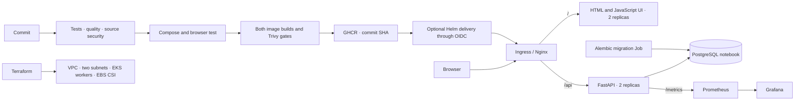

# Orbit · Scientific Calculator

A simple scientific calculator built in **Python with FastAPI**, with a responsive HTML/CSS/JavaScript interface and a PostgreSQL calculation notebook. Evaluate expressions, switch radians/degrees, revisit saved calculations, label them, and delete them.

Repository: **https://github.com/Yeashu/DevOps-Capstone**

**All ten rubric modules have implementation files. Live deployment and submission evidence remain outstanding.** See [validation results](docs/VALIDATION.md) and [the submission checklist](SUBMISSION.md). This session created no AWS resources and published no images; it does not claim a successful hosted pipeline or deployment.

## Run the application

With Docker running, from this directory:

```bash
docker compose up --build
```

Open **http://localhost:3000**. API documentation: http://localhost:8000/docs. Compose includes a classroom-only password; copy `.env.example` to `.env` to replace it. Use URL-safe letters, digits, hyphens and underscores in the Compose password because it is interpolated into a URL. The Kubernetes secret helper correctly encodes arbitrary passwords.

```text
sqrt(144) + 2^3   → 20
sin(pi / 2)      → 1       RAD
sin(30)          → 0.5     DEG
log(1000)        → 3       base 10
ln(e)            → 1
factorial(5)     → 120
```

Use explicit multiplication (`2*pi`) and parentheses. Press Enter or Calculate to evaluate and save. The classroom notebook is shared; there are no user accounts. Calculations use floating-point arithmetic; the UI displays 12 significant digits while the API retains the full floating-point result.

## Architecture and files



| Area | Files |
| --- | --- |
| Python API and restricted expression parser | `backend/app/` |
| Alembic migration | `backend/alembic/versions/0001_calculations.py` |
| Engine and API tests | `backend/tests/`, `backend/pytest.ini` |
| Responsive frontend and Node build | `frontend/` |
| Non-root Dockerfiles and three-service stack | `backend/Dockerfile`, `frontend/Dockerfile`, `docker-compose.yml` |
| GitHub Actions | `.github/workflows/ci.yml` |
| AWS infrastructure | `terraform/` |
| Kubernetes and Helm | `k8s/`, `helm/orbit/` |
| Prometheus and Grafana | `monitoring/` |
| Optional Argo CD workflow | `gitops/` |
| Live screenshot capture | `scripts/`, `screenshots.md` |

## Development and testing

Containers and CI use Python 3.13 and Node 24. Plain HTML/JavaScript satisfies the rubric's HTML frontend option. Its Node production build validates JavaScript and produces Nginx assets without a browser framework.

```bash
python3.13 -m venv .venv
.venv/bin/pip install -r backend/requirements-dev.txt pillow
cd backend
../.venv/bin/alembic upgrade head
../.venv/bin/uvicorn app.main:app --reload --port 8000
```

Host development defaults to a local SQLite file. **Compose and Helm use PostgreSQL.** Alembic owns the schema in both modes; application startup does not call `create_all`. For the full UI with same-origin API routing, use Compose.

Run checks from the repository root:

```bash
cd backend
../.venv/bin/pytest -v
../.venv/bin/ruff check app tests alembic
cd ../frontend
npm ci --ignore-scripts
npm test
npm run build
```

API tests apply migrations to isolated temporary SQLite databases by default. CI sets `TEST_DATABASE_URL` to a disposable PostgreSQL database named `orbit_test`, exercising the same API tests against PostgreSQL. The test fixture never chooses its database using production `DATABASE_URL`, refuses external database names without `_test`, and clears that dedicated test table between tests. Do not point it at shared data.

Engine-only tests need just pytest: `cd backend && ../.venv/bin/pytest -v tests/test_calculator.py`.

## API and database

| Method | Endpoint | Behavior |
| --- | --- | --- |
| GET | `/health`, `/api/health` | Process health and image version |
| GET | `/ready` | Database/schema readiness; 503 when unavailable |
| GET | `/metrics` | Prometheus request counters and latency histogram |
| POST | `/api/evaluate` | Evaluate without saving |
| POST | `/api/calculations` | Evaluate and persist; 201 |
| GET | `/api/calculations?limit=50&offset=0` | Newest-first notebook |
| GET | `/api/calculations/{id}` | Read a calculation |
| PUT | `/api/calculations/{id}` | Change its label |
| DELETE | `/api/calculations/{id}` | Delete; 204 |

```bash
curl -X POST http://localhost:8000/api/calculations \
  -H 'Content-Type: application/json' \
  -d '{"expression":"sin(30)","angle_mode":"deg","label":"Trig example"}'
```

The `calculations` table stores `id`, `expression`, `result`, `angle_mode`, `label`, and `created_at`. Invalid math returns 422 without saving; unknown IDs return 404. A bounded AST interpreter accepts only arithmetic, known constants and approved one-argument functions. There is no `eval`, import, attribute access or arbitrary Python execution.

## Docker

The backend uses a Python build stage and runtime UID 10001. The frontend uses a **Node build stage followed by unprivileged Nginx**, UID 101, internally listening on 8080. Compose publishes only localhost:3000 and localhost:8000. PostgreSQL health gates API startup; the API applies migrations before serving.

```bash
docker compose up --build -d --wait
docker compose ps
docker compose exec -T backend id
docker compose exec -T frontend id
docker compose down
```

`down` preserves notebook data. Add `-v` only to erase the local demo database.

## CI/CD and security

Every push to `main`, pull request to `main`, and manual dispatch runs:

1. PostgreSQL-backed pytest and Ruff; frontend tests/build; Bandit SAST, pip-audit SCA and Trivy secret detection; Terraform/Helm checks.
2. The complete Compose stack and Playwright browser checks with desktop/mobile screenshot artifacts.
3. Both image builds and Trivy vulnerability scans. **Any HIGH or CRITICAL finding blocks the run, including unfixed CVEs.**
4. Publication of the exact scanned images only after **both** scans succeed. Pull requests do not publish.
5. Optional EKS delivery using the same full commit SHA.

Image names are `ghcr.io/yeashu/devops-capstone/backend:<full-sha>` and `ghcr.io/yeashu/devops-capstone/frontend:<full-sha>`. No deployment uses `latest`. GitHub's scoped automatic token publishes; AWS OIDC handles cloud access. Reports and browser evidence are retained as Actions artifacts. See [security notes](security/README.md).

Delivery is disabled until bootstrap is complete. Configure a GitHub Environment named `capstone`, an AWS OIDC role restricted to `repo:Yeashu/DevOps-Capstone:environment:capstone`, and a Linux self-hosted runner labelled `capstone` with AWS CLI, kubectl and access to EKS. Helm is installed by its setup action. An in-VPC runner reaches the private endpoint; an external runner needs a fixed egress `/32` in `admin_cidrs`. Grant the role `eks:DescribeCluster` on this cluster and pass its ARN as Terraform's `deploy_principal_arn` for namespace access.

Set variables `DEPLOY_TO_EKS=true`, `AWS_ROLE_ARN`, `AWS_REGION`, `EKS_CLUSTER`, `INGRESS_HOST`. An administrator must first create the namespace, database Secret, storage class and Ingress controller. Make GHCR packages public, or set chart `imagePullSecrets`. Keep direct delivery disabled when using the optional Argo CD workflow, so both systems do not manage the same release.

## Kubernetes and Helm

With a running Minikube profile, Docker and Helm:

```bash
./scripts/deploy-local.sh
kubectl get pods -n orbit
kubectl get svc -n orbit
helm list -n orbit
kubectl port-forward -n ingress-nginx svc/ingress-nginx-controller 8080:80
```

Open **http://orbit.localhost:8080** through the actual Ingress. If your browser does not resolve `.localhost`, add a local DNS/hosts entry. CLI check: `curl -H 'Host: orbit.localhost' http://127.0.0.1:8080/api/health`.

The helper uses an explicit Minikube context. Manual installation to your chosen cluster is:

```bash
kubectl apply -f k8s/namespace.yaml
python3 scripts/create-db-secret.py
helm upgrade --install orbit ./helm/orbit -n orbit --wait --wait-for-jobs --timeout 10m
```

Load local images first or set both component repositories and tags to published GHCR images. The chart provides two replicas each, ClusterIP Services, Ingress, ConfigMap, PVC and a single migration Job per release revision. Backend init containers wait for the schema instead of competing to run migrations. Completed migration pods are expected; application pods must be Running/Ready. New migrations require updating the expected revision in the readiness init script.

For EKS, apply `k8s/storageclass-eks.yaml` and set `database.persistence.storageClass=gp3`. Terraform installs EBS CSI with Pod Identity permissions. The optional HPA needs metrics-server and retains a minimum of two backend replicas. PostgreSQL PVCs intentionally survive Helm uninstall; remove them deliberately during final cleanup.

## Terraform and AWS

The code defines a VPC, two public subnets in different AZs, internet gateway, EKS, managed worker group, EBS CSI/Pod Identity and optional scoped CI access. Public-subnet workers avoid a NAT Gateway in this temporary classroom setup. The public API is CIDR restricted and a private endpoint is enabled. No SSH ingress is created.

```bash
aws sso login --profile YOUR_PROFILE
export AWS_PROFILE=YOUR_PROFILE
cd terraform
cp terraform.tfvars.example terraform.tfvars
# Edit your public IPv4 /32, region and desired cluster version.
terraform init
terraform fmt -check
terraform validate
terraform plan -out=orbit.tfplan
terraform apply orbit.tfplan
terraform output kubeconfig_command
```

Verify the default Kubernetes 1.36 is available in your region with `aws eks describe-cluster-versions`; see the [AWS EKS lifecycle](https://docs.aws.amazon.com/eks/latest/userguide/kubernetes-versions.html). Credentials use the AWS chain, never committed files. Plans, state and real `.tfvars` are gitignored. The matching cached AWS provider supplied the lock checksums; offline initialization reported its installation as unauthenticated. With network access, refresh official checksums: `terraform providers lock -platform=darwin_arm64 -platform=linux_amd64`.

After evaluation, uninstall application, monitoring and Ingress releases, delete application PVCs, and verify load balancers/volumes are removed while the cluster still exists. Then run `terraform destroy`, capture its real completion output, and check `terraform state list` and the AWS Console. Do not destroy another coursework stack. This session did not apply this configuration.

## Prometheus and Grafana

```bash
./scripts/install-monitoring.sh
kubectl port-forward -n monitoring svc/prometheus-server 9090:80
# Separate terminal:
kubectl port-forward -n monitoring svc/grafana 3001:80
# Separate terminal; generate real metrics without filling the notebook:
python3 scripts/generate-traffic.py --url http://orbit.localhost:8080 --seconds 180
```

Check both `orbit-api` targets are UP at http://localhost:9090/targets. Grafana at http://localhost:3001 uses `admin` and the password chosen during installation. **Orbit · Application Metrics** includes request rate, p95 latency, per-route requests, error ratio, replica health and total requests. Allow at least two scrapes and one minute of traffic for rate panels. Monitoring storage is ephemeral for this demo.

## Evidence and presentation

- [Screenshot index](screenshots.md) and [rubric checklist](SUBMISSION.md)
- [Presentation and commit → pipeline → deployment demo](DEMO.md)
- [Validation record](docs/VALIDATION.md) and [troubleshooting exercises](docs/TROUBLESHOOTING.md)
- [Optional GitOps setup](gitops/README.md)

After installing backend dependencies and Pillow, run `./scripts/capture-evidence.sh` for the local stack and `./scripts/capture-cluster.sh` for live Kubernetes state. The browser script refuses application evidence if the API is unavailable and deletes only the example records it created. Command images are explicitly labelled **rendered transcripts**, with original logs retained; they are not desktop screenshots.

## Reference and lessons

The [ClinicDesk reference](https://github.com/Datman701/devops_capstone) was reviewed as a structural benchmark. Orbit's calculator domain, interpreter, notebook schema, tests, UI and deployment files were authored for this project. The reference application and its screenshots were not copied.

Discuss test database isolation, readiness versus liveness, a single migration owner, scans before publishing, and why configuration files alone do not prove a deployment. Add your own observations after completing the live demonstration.
